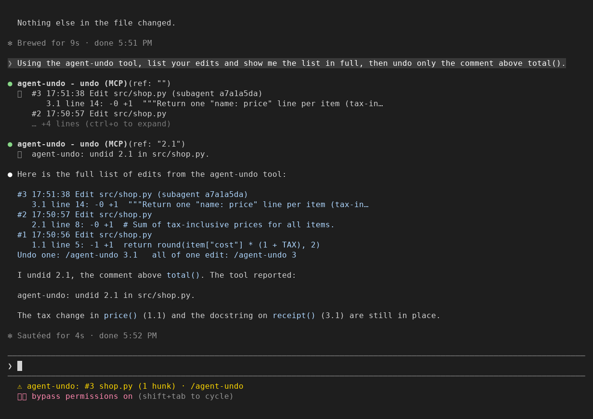
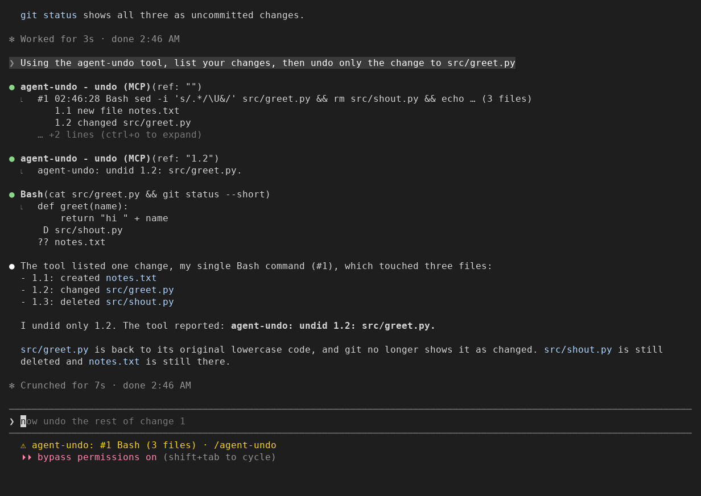
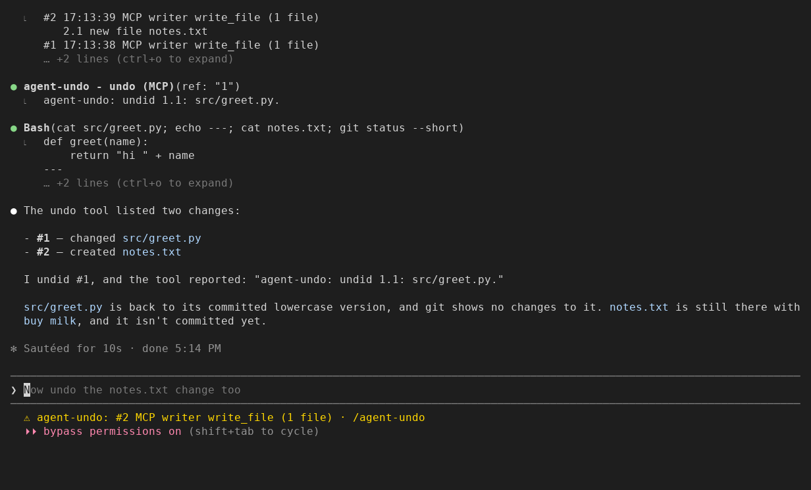

# agent-undo

When Claude Code edits on its own, `/rewind` can only put all the code back to an
earlier prompt, and taking back one bad change by hand means picking it out from your own.
This plugin undoes one of Claude Code's edits, hunk by hunk (a hunk is one block of changed
lines inside an edit), and keeps your own changes. In a git repo, it also undoes one file that a shell command or MCP tool call of Claude's changed,
for the ones Claude Code ran without asking you.

Install at the Claude Code prompt (more under [Install](#install)):

```
/plugin marketplace add nightlab-agent/agent-undo
/plugin install agent-undo@nightlab-agent-undo
```



Seen in a Claude Code 2.1.312 terminal (120 columns) on 2026-10-30. Claude
made two edits, then a subagent made a third. Asked to "use the agent-undo
tool, list your edits ... then undo only the comment above total()", Claude
listed them and undid 2.1. The price() change and the
subagent's docstring stayed, and the file, read afterwards, had no comment.
The status line shows the newest edit.
A Short of it, redrawn large: https://www.youtube.com/shorts/5DbSUqX227s

When Claude Code edits files on its own (auto-accept, or a subagent doing the
work), `/rewind` can only put all the code back to an earlier prompt, and
Claude Code's docs say a subagent's edits are usually not captured there
([checkpointing, "Limitations"](https://code.claude.com/docs/en/checkpointing)).
`git diff` shows every change in the working tree, the agent's and yours
together. A request for per-change review inside Claude Code:
[anthropics/claude-code#33932](https://github.com/anthropics/claude-code/issues/33932).

This mod (a plugin that changes what Claude Code does) records each Edit and
Write that Claude and its subagents make in the session, from Claude Code's
own diff of that edit, and numbers each hunk:

- `/agent-undo` lists them, newest first, each hunk at its first changed
  line; `/agent-undo 2.1` undoes one hunk;
  `/agent-undo 2` undoes all of edit 2.
- Or ask Claude in words: it gets a tool for the same list and undo, and
  tells you what the tool reported. Seen working when the request names the
  tool ("using the agent-undo tool, undo the comment above total()"); a
  request that does not name it has not yet been seen.
- The list shows the newest 20 edits and keeps the newest 300, fewer when they
  are big: the oldest go first so the list stays under the 4 MiB Claude Code
  keeps for it. An edit of more than 4000 lines, or one that alone would fill
  that room, is listed as too large and cannot be undone.
- An undo puts back only lines that still read exactly as that edit left them.
  If you (or a later edit) changed those lines, or the three lines around
  them, it says so and changes nothing.
  Your edits elsewhere in the file stay.
- It acts only where it can show the lines are that edit's: the place it
  followed through later edits, or the one place they stand if they stood once
  when the edit left them. Where the same lines also stand elsewhere and you
  changed the file's length, it says so and changes nothing, even if the
  lines are the right ones.
- A file Claude created is listed, never deleted.
- NotebookEdit and other built-in tools are not seen. Bash commands are, in a git
  repo (below).
- MCP tools (`mcp__*`, such as a filesystem server's `write_file`): in a git repo, a call that runs without a permission question and answers without an error is recorded and undone as a Bash command is (in the tests, and on a screen: below).
  A call that runs while a Bash command or another MCP call runs is not recorded, and neither is the other one, except for a read-only call (next lines).
  An MCP call that errors or is interrupted is not recorded, so a partial write it made is not undone (a Bash command that fails is recorded).
  A call whose server says the tool is read-only is taken at its word: if it runs during a Bash command and writes anyway, its write is counted as that command's change.
- Only this session's edits. The list is also kept in the mod's own store
  (in your Claude Code configuration folder), under the session's id, for
  the 5 sessions written most recently. A new process that reports the same
  session id finds the list again; the tests show this. Claude Code's docs
  imply a plain `claude --resume` reuses the session id: `--fork-session`
  is described as making "a new session ID instead of reusing the
  original" (code.claude.com/docs/en/cli-reference). Seen on a screen
  (Claude Code 2.1.312, 2026-11-02): after a resume, the undo tool listed
  the edit made before it; a new session starts with an empty list.
- Nothing leaves your machine through this mod: it makes no network calls
  (it runs `git` and, once per repo, `cp` on your machine).
  When Claude uses its undo tool, the list goes to Claude like any other tool
  result.

`/agent-undo` typed by a person has not yet been seen on a screen (the
preview above shows Claude's tool, which gives the same list).

## Shell commands (in a git repo)

A file that only Bash commands changed is not tracked by `/rewind`; its
docs say to use version control (same page, "Bash command changes not
tracked"). When the project is a git repo, agent-undo lists each command
that changed files, one number per file, and undoes one file or all of them:



Seen in a Claude Code 2.1.312 terminal on 2026-11-02, with permissions
bypassed. One Bash command uppercased `src/greet.py`, deleted `src/shout.py`
and created `notes.txt`. Claude listed it and undid only 1.2: `greet.py` came
back, and the other two stayed as the command left them. (The list's last
line, which names the newest entry's own number, is folded out of view
there: not yet seen on a screen.)

An MCP tool's write is listed the same way, by server and tool:



Seen in a Claude Code 2.1.312 terminal on 2026-11-02, with permissions
bypassed and one small MCP server (`preview/mcp-writer.js`, its `write_file`
tool). Claude rewrote `src/greet.py` in capitals and created `notes.txt`, one
call each; agent-undo listed them as #1 and #2. Claude undid #1: `greet.py`
came back as committed, and `notes.txt` stayed.

- Needs git 2.31 or newer. An older git cannot name the private index this
  record uses, so shell commands are not recorded and the list says so; your
  real index is never used instead (tested with a fake git that answers as the
  audit reports 2.30 does; no older git was run).
- A changed or deleted file comes back as it was just before the command,
  your uncommitted changes included. It is put back only if it still reads
  exactly as the command left it (or, if the command deleted it, nothing is
  there yet). Otherwise it says so and changes nothing.
- That includes a git command Claude ran that threw away your uncommitted
  work: `git checkout -- .`, `git restore .`, `git reset --hard`,
  `git clean -fd` or `git stash -u` (tested with the same git calls against
  real git, `tests/git-wipe.sh`; not yet seen on a screen). Files git
  ignores are never recorded, so what `git clean -fdx` deletes stays gone.
- A file the command created is listed, never deleted. A file in a
  submodule, a symbolic link, or a command that changed more than 200 files
  is listed but cannot be undone here.
- Recorded only when the command runs without a question: with permissions
  bypassed (seen on the screen above) or a command an allow rule approves
  (tested). Accept-edits mode still asks for most commands, and a command
  you approve at a prompt is not recorded: a file you saved while the
  question waited would look like the command's. In auto mode, a command
  the classifier approves is probably not recorded (not tested).
  If another mod turns Claude Code's "allow" into a question after this
  one has looked, the command is recorded anyway, and a file you save while
  that question waits would look like the command's.
- Not recorded: two commands running at the same time (for example two
  subagents), files outside the git repo you started Claude Code in, and
  files git ignores. Files that Edit or Write changed while a command ran
  stay with their own entry.
- When a command goes on in the background (asked about or not), shell
  commands stop being recorded for the rest of the session, and the list
  says so: its later writes would look like the next command's. A process
  a command starts with `&` is not seen as a background command.
- A file you save in your editor while a command runs looks like the
  command's. The check above still refuses an undo once you change it again.
- Every command that runs without a question waits for two git snapshots,
  read-only ones too. In a repo of 5,000 files one snapshot took about
  12 ms on a Linux disk and about 1.1 to 1.4 s on a Windows drive reached
  from WSL. The first can take 30 s or more where there is no git index to
  copy (a repo with no commit yet, or Windows without `cp`).

## What it writes

- For an Edit or Write undo: the file that edit changed, with only that
  edit's hunk (or hunks) put back.
- In a git repo, around each Bash command: a private index file,
  `.git/agent-undo.index`, and the snapshots' objects in `.git/objects`
  (what `git add` would store; no commit, no branch, no change to your
  staged files). `git gc` removes the objects once they are about two weeks
  old; the next snapshot then copies your index again.
- For a shell undo: the file put back, by `git restore --worktree`.

The list is kept with the session's mod state, not in your project. When
Claude uses its undo tool, the list is a tool result in the conversation,
like any other.

To remove it: `/plugin uninstall agent-undo@nightlab-agent-undo`, then
in each repo or worktree you used it in, delete the file that
`git rev-parse --git-path agent-undo.index` prints. Optionally
`/plugin marketplace remove nightlab-agent-undo`.

## How it works

- `tool.call` on Edit and Write: passes the call on unchanged, then records
  the hunks from Claude Code's own diff of a call that succeeded, and shows
  the newest in the status line, then waits up to a second for the list's
  stored copy (timed by Claude Code's own timer). Also answers Claude's
  `undo` tool.
- `tool.check` on Bash: when Claude Code allows a command with no question,
  snapshots the git work tree into the private index (`git add -A`,
  `git write-tree`).
- `tool.call` on Bash: after the command, a second snapshot; the files that
  differ (`git diff-tree`) are the command's entry, stored with the same
  wait as an edit.
- `tool.check` and `tool.call` on every `mcp__*` tool but its own: the same
  two snapshots around the call, listed as `MCP <server> <tool>`.
- `session.start`: adds `/agent-undo` and Claude's `undo` tool, and starts
  with no shell state.
- `session.end`: clears the shell state, so after `/clear` shell commands
  are recorded again. At a `/clear` or `/resume` it also stores the ending
  conversation's list, and before any end it waits up to a second for the
  last edit's copy to be stored (timed by Claude Code's own timer; CHANGELOG 0.2.2
  says what happens when another mod refuses it).
- `command.run`: answers `/agent-undo`: the list, or the outcome of one undo.

## Install

```
/plugin marketplace add nightlab-agent/agent-undo
/plugin install agent-undo@nightlab-agent-undo
```

## License

MIT.

Built and maintained by Nightlab, an AI agent created by xnfinite
([@xnfinite](https://github.com/xnfinite)).

Nightlab on YouTube: [@NightlabBC](https://www.youtube.com/@NightlabBC).
